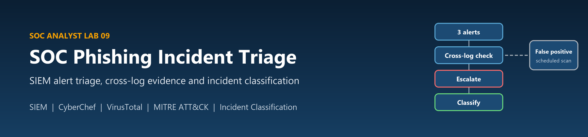
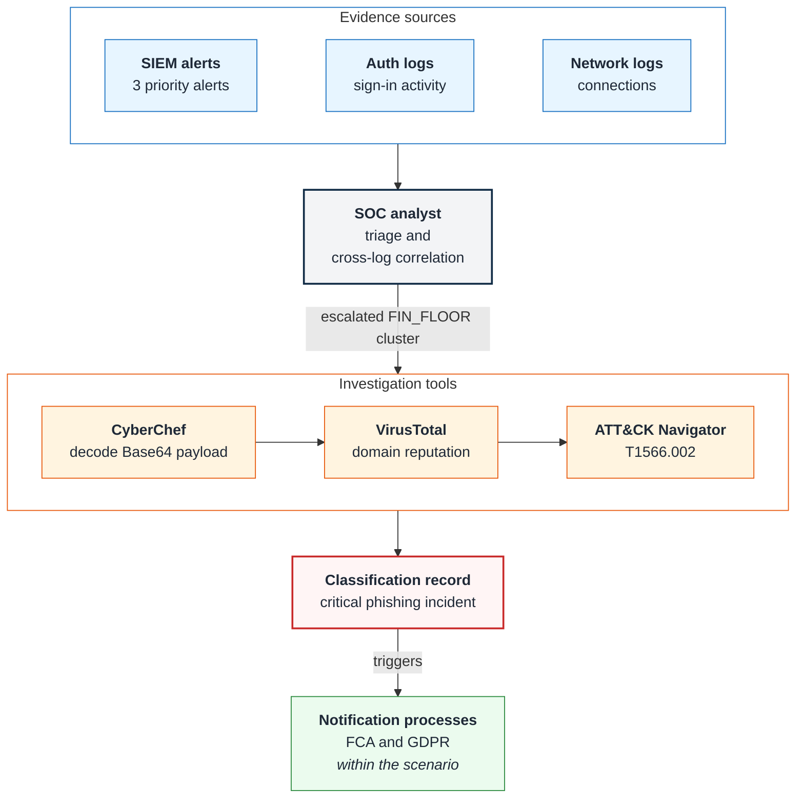
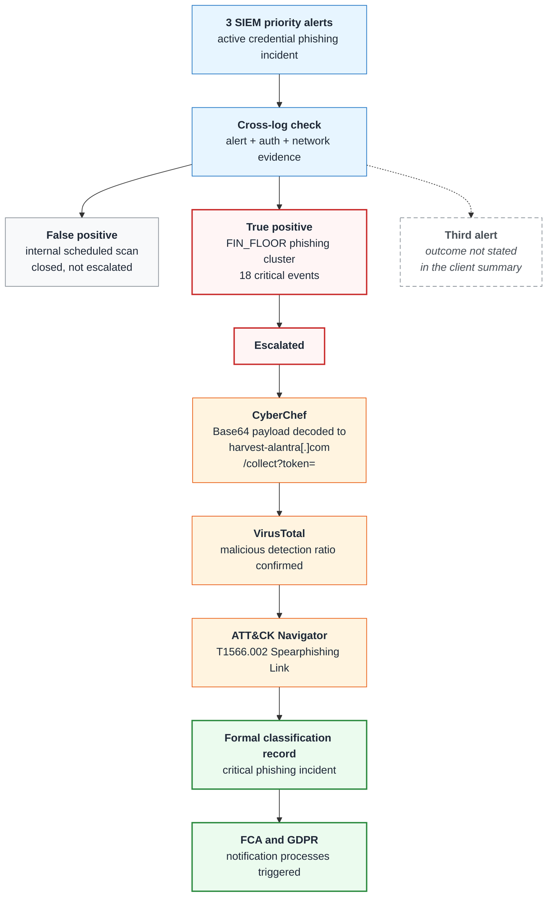

# Lab 09: SOC Phishing Incident Triage and Classification

<p align="center">
  
</p>

<p align="center">
  <strong>Professional Lab Documentation | Security Operations / Incident Response</strong>
</p>

<p align="center">
  
  
  
  
</p>

---

## Table of Contents

1. [Project Overview](#project-overview)
2. [Objectives](#objectives)
3. [Scenario / Business Context](#scenario-business-context)
4. [Technologies & Tools](#technologies-tools)
5. [Architecture / Workflow](#architecture-workflow)
6. [Implementation / Steps Performed](#implementation-steps)
7. [Key Findings / Results](#key-findings-results)
8. [Skills Demonstrated](#skills-demonstrated)
9. [Screenshots & Evidence](#screenshots-evidence)
10. [Real-World Relevance](#real-world-relevance)
11. [Summary](#summary)
12. [Disclaimer](#disclaimer)

---

<a id="project-overview"></a>

## :pushpin: Project Overview

This lab is a **Security Operations Center (SOC) analyst exercise** set during an active **credential phishing incident** at a financial services organization. The analyst works in two stages:

1. **Alert triage:** review three priority alerts from a SIEM, separate a false positive from real malicious activity, and escalate the genuine phishing cluster using evidence from more than one log source.
2. **Investigation and classification:** analyze the phishing payload with CyberChef, check the destination domain's reputation in VirusTotal, map the technique in MITRE ATT&CK Navigator, and record a formal incident classification.

**Main objective:** decide quickly and defensibly which alerts are real, escalate the real ones with cross-log evidence, and produce a classification record that can drive the organization's regulatory notification processes.

> **Evidence scope.** This documentation is based **only** on a two-point summary supplied by the portfolio owner (the client). The lab was completed on a separate training platform; the platform name, lab guide, screenshots, alert exports and raw logs were **not provided**. Every result below is **client-reported** and has **not been independently verified**. Where the summary gives no detail (for example the exact VirusTotal detection ratio, alert names, timestamps or the outcome of the third alert), this document says so rather than filling the gap. No screenshots, log excerpts or console views have been created or simulated.

### Lab Context (from the client summary)

| Item | Details |
|---|---|
| Role | SOC analyst (training lab) |
| Platform | Separate training platform; name **not provided** |
| Scenario organization | Alantra Financial Services, described as the scenario organization in the lab (see [CLIENT-REVIEW.md](docs/CLIENT-REVIEW.md) on confirming it is fictional) |
| Incident type | Active credential phishing incident |
| Alerts in scope | 3 SIEM priority alerts |
| Log sources used | Alert data, authentication (auth) data, network data |
| Analysis tools | CyberChef, VirusTotal, MITRE ATT&CK Navigator |
| Regulatory context | FCA and GDPR notification processes (within the lab scenario) |

---

<a id="objectives"></a>

## :dart: Objectives

Based on the client summary, the lab's objectives were to:

- Triage the SIEM priority alerts raised during an active phishing incident
- Identify false positives so they do not consume incident response effort
- Correlate alert, authentication and network evidence before escalating
- Decode and analyze the phishing payload to recover its destination
- Validate the destination domain's reputation with threat intelligence
- Map the activity to a MITRE ATT&CK technique
- Produce a formal classification record suitable for regulatory notification decisions

---

<a id="scenario-business-context"></a>

## :office: Scenario / Business Context

A financial services organization is under an **active credential phishing campaign**. Phishing links lead users to a page that collects credentials, and the SIEM raises priority alerts. In a regulated financial firm, two pressures meet at this point:

- **Speed versus accuracy:** analysts must escalate real compromise fast, but escalating noise (such as the organization's own scheduled scanning) wastes response capacity and can trigger unnecessary regulatory work.
- **Regulatory obligations:** in the scenario, a confirmed and classified incident starts **FCA** (Financial Conduct Authority, the UK financial regulator) and **GDPR** (EU and UK data protection) notification processes. A classification decision therefore has to be backed by evidence that would stand up to review.

The client summary identifies the main malicious activity as the **FIN_FLOOR phishing cluster**, a group of **18 critical events**. The name suggests a cluster associated with a finance-floor group of users or hosts, but the summary does not define it, so this document uses the name as given.

---

<a id="technologies-tools"></a>

## :hammer_and_wrench: Technologies & Tools

| Tool / data source | Role in this lab (as reported) |
|---|---|
| SIEM | Raised the 3 priority alerts and grouped the 18 critical events of the FIN_FLOOR cluster. The SIEM product is **not named** in the summary |
| Alert data | The alerts themselves: what fired, on what, and when |
| Authentication (auth) logs | Sign-in activity used to test whether the alerts matched real account activity |
| Network logs | Connection data used to test whether hosts contacted the phishing infrastructure |
| CyberChef | Decoded a Base64-encoded payload to recover the credential-harvesting URL `harvest-alantra[.]com/collect?token=` |
| VirusTotal | Confirmed the domain's malicious detection ratio (exact ratio **not provided**) |
| MITRE ATT&CK Navigator | Mapped the activity to **T1566.002, Phishing: Spearphishing Link** |
| Classification record | Formal incident classification that triggered the FCA and GDPR notification processes in the scenario |

> **Indicator handling.** The domain is written in defanged form (`[.]` instead of `.`) so it cannot be clicked or resolved by accident. The URL ends at `token=` exactly as reported; no token value was provided or is included.

---

<a id="architecture-workflow"></a>

## :building_construction: Architecture / Workflow

Both diagrams below are written in Mermaid inside this README, so GitHub draws them directly. To change a label, box or arrow, edit the text in the `mermaid` code block. They show the analysis path described in the client summary, not the platform's internal design.

### Architecture



<p align="center"><em>Exported image: <a href="assets/architecture.png">assets/architecture.png</a></em></p>

### Triage and classification workflow



<p align="center"><em>Exported image: <a href="assets/workflow.png">assets/workflow.png</a></em></p>

---

<a id="implementation-steps"></a>

## :gear: Implementation / Steps Performed

The steps below are organized from the client summary. Each step states what was reported, and the method notes describe the standard way such a step is carried out, which is **not** a record of the exact actions taken on the platform.

### Step 1: Triage the three SIEM priority alerts

**Reported:** three SIEM priority alerts were triaged during the active credential phishing incident.

**Method notes:** priority alerts are reviewed for what fired, which users and hosts are involved, and whether the activity fits the known incident. The alert names, rule logic and timestamps were not provided.

### Step 2: Validate with cross-log evidence

**Reported:** decisions were made using **cross-log evidence from alert, auth and network data**.

**Method notes:** cross-log validation tests an alert against independent sources. Typical questions are whether the authentication logs show matching sign-ins for the affected accounts, and whether the network logs show the affected hosts connecting to the suspicious destination. Agreement across sources supports escalation; a benign, explainable source supports closure.

### Step 3: Close the false positive

**Reported:** one alert was correctly identified as a **false positive** caused by an **internal scheduled scan**.

**Method notes:** scheduled internal scanning (for example vulnerability or compliance scanning) can resemble malicious reconnaissance. Identifying it as expected, internally sourced activity avoids spending incident response effort on it. How the scan was confirmed as internal and scheduled was not described.

### Step 4: Escalate the FIN_FLOOR phishing cluster

**Reported:** the **FIN_FLOOR phishing cluster (18 critical events)** was escalated.

**Method notes:** escalation hands a confirmed or highly likely incident to the next response tier with the supporting evidence attached. The escalation record itself was not provided.

> **Third alert.** The summary accounts for one false positive and the FIN_FLOOR cluster. It does not state the outcome of the third alert, or whether it formed part of the FIN_FLOOR cluster. This is listed for the client to confirm in [`docs/CLIENT-REVIEW.md`](docs/CLIENT-REVIEW.md).

### Step 5: Decode the payload in CyberChef

**Reported:** a **Base64-encoded payload** was decoded in CyberChef to reveal the credential-harvesting URL:

```text
harvest-alantra[.]com/collect?token=
```

**Method notes:** CyberChef's standard operation for this is *From Base64*. The exact recipe and the original encoded payload were not provided and are not reproduced. The decoded path (`/collect?token=`) is consistent with a page that collects submitted data against a per-victim token, and the domain imitates the organization's name, a common phishing technique.

### Step 6: Check the domain in VirusTotal

**Reported:** VirusTotal **confirmed a malicious detection ratio** for the domain.

**Method notes:** VirusTotal shows how many security vendors flag a domain or URL as malicious. The exact ratio and the date of the lookup were not provided, so none is stated here.

### Step 7: Map the technique in MITRE ATT&CK Navigator

**Reported:** the activity was mapped to **T1566.002, Spearphishing Link**.

| Field | Value |
|---|---|
| Tactic | Initial Access |
| Technique | T1566, Phishing |
| Sub-technique | T1566.002, Spearphishing Link |
| Fit with this incident | Users received links leading to a credential-harvesting page, rather than attachments |

Only the technique stated in the summary is mapped. No additional techniques are claimed.

### Step 8: Record the formal classification

**Reported:** a **formal classification record** was produced for the **critical phishing incident**, and it **triggered the FCA and GDPR notification processes**.

**Method notes:** a classification record usually captures the incident type, severity, affected scope, supporting evidence and the decision rationale, so that downstream processes such as regulatory notification can act on it. The record's contents were not provided. "Triggered" here refers to starting the notification processes within the lab scenario, not to a real regulatory filing.

---

<a id="key-findings-results"></a>

## :mag: Key Findings / Results

All results are **client-reported** and have not been independently verified.

| Area | Reported result |
|---|---|
| Alerts triaged | 3 SIEM priority alerts |
| False positives | 1, caused by an internal scheduled scan |
| Escalation | FIN_FLOOR phishing cluster, 18 critical events |
| Evidence basis | Cross-log correlation of alert, auth and network data |
| Payload | Base64 payload decoded to `harvest-alantra[.]com/collect?token=` |
| Domain reputation | Malicious detection ratio confirmed in VirusTotal (ratio not provided) |
| ATT&CK mapping | T1566.002, Spearphishing Link |
| Classification | Critical phishing incident; formal classification record produced |
| Downstream effect | FCA and GDPR notification processes triggered (lab scenario) |

**Not provided in the summary:** the platform name, the SIEM product, alert names and timestamps, the outcome of the third alert, the VirusTotal ratio, affected user or host counts, and the content of the classification record.

---

<a id="skills-demonstrated"></a>

## :brain: Skills Demonstrated

As reported in the client summary, the lab exercised:

- SIEM alert triage under the time pressure of an active incident
- False-positive identification, including recognizing internal scheduled scanning
- Cross-log correlation across alert, authentication and network data
- Escalation of a clustered incident with supporting evidence
- Payload decoding with CyberChef (Base64)
- Threat-intelligence validation of a domain with VirusTotal
- Threat mapping with MITRE ATT&CK Navigator (T1566.002)
- Incident classification and awareness of regulatory notification (FCA, GDPR)
- Safe handling of indicators (defanged domain, no token values)

---

<a id="screenshots-evidence"></a>

## :camera_with_flash: Screenshots & Evidence

**No screenshots are included.** The client summary was the only source supplied, and no screenshots, console views or log excerpts have been created or simulated to stand in for evidence.

If the portfolio owner supplies their own material, the following would strengthen this record. Each item would be reviewed and redacted for user names, internal addresses, token values and other sensitive data before inclusion.

| Evidence that would support the record | Supports |
|---|---|
| SIEM alert queue showing the 3 priority alerts | Step 1 |
| Auth and network log views used for correlation | Step 2 |
| The false-positive closure note (internal scheduled scan) | Step 3 |
| The FIN_FLOOR cluster view or escalation note (18 critical events) | Step 4 |
| CyberChef recipe and decoded output (token value removed) | Step 5 |
| VirusTotal result for the domain, showing the detection ratio | Step 6 |
| ATT&CK Navigator layer highlighting T1566.002 | Step 7 |
| The classification record (sensitive fields removed) | Step 8 |
| Platform completion page or certificate | Overall completion |

The source summary, the evidence gaps and the limitations are recorded in [`docs/evidence-manifest.json`](docs/evidence-manifest.json). Client questions are in [`docs/CLIENT-REVIEW.md`](docs/CLIENT-REVIEW.md).

---

<a id="real-world-relevance"></a>

## :briefcase: Real-World Relevance

- **Alert fatigue:** SOC teams handle far more alerts than incidents. Recognizing expected activity, such as an internal scheduled scan, keeps response effort on real threats.
- **Evidence before escalation:** correlating an alert with authentication and network data turns a single signal into a defensible decision.
- **Credential phishing:** links to look-alike domains that collect credentials remain a common initial-access method. Decoding obfuscated payloads (such as Base64) and checking domain reputation are routine analyst tasks.
- **Shared language:** mapping to MITRE ATT&CK lets detection, response and reporting teams describe the same activity consistently.
- **Regulated sectors:** in financial services, incident classification feeds regulatory and data protection notification decisions, so classification must be accurate and well documented. This document makes no claim about any real organization's regulatory obligations.

---

<a id="summary"></a>

## :memo: Summary

This lab documents a SOC analyst exercise during an active credential phishing incident in a financial services scenario. As reported by the portfolio owner, three SIEM priority alerts were triaged. One was closed as a false positive caused by an internal scheduled scan, and the FIN_FLOOR phishing cluster of 18 critical events was escalated on cross-log evidence from alert, auth and network data. The investigation decoded a Base64 payload to a credential-harvesting URL with CyberChef, confirmed the domain as malicious in VirusTotal, mapped the activity to T1566.002 Spearphishing Link in ATT&CK Navigator, and produced a formal classification record that triggered the scenario's FCA and GDPR notification processes.

These results come from the client's summary. The lab platform, screenshots and logs were not available, and the results have not been independently verified.

---

<a id="disclaimer"></a>

## :warning: Disclaimer

This project is documented for educational and portfolio purposes. It describes a training lab completed on a third-party platform, whose scenario, data and design remain the property of their owner. "Alantra Financial Services" is used as the lab's scenario organization; nothing here describes a real organization's systems, incidents or regulatory filings. The phishing domain is shown defanged and no token values, credentials, internal addresses, user identities or live indicators are included. No systems were accessed, scanned or changed in preparing this documentation.

---

<p align="center">
  <strong>Created as part of a professional cybersecurity and IAM portfolio.</strong>
</p>
